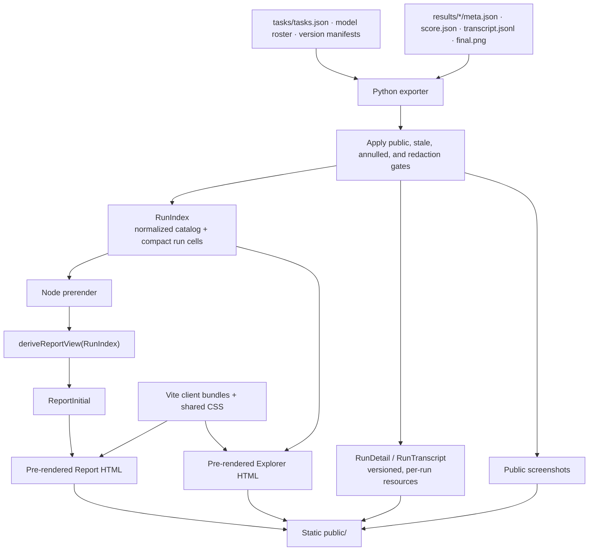

# Report frontend contract

## Decision

Replace `runner/report.py`'s hand-built HTML and inline browser scripts with a pre-rendered static site built with Vite, Preact, and TypeScript.

The reason is not simply that JSX is nicer than Python strings. The previous Python report implemented the same rendering and aggregation rules twice:

- Python renders the hero, matrix, breakdowns, scatter plot, label placement, formatting, and scoring aggregates.
- `TOGGLE_JS` re-rendered those same views as JavaScript strings whenever visible models changed.

That includes duplicate scatter helpers (`_nice_ticks`/`niceTicks`, `_marker`/`marker`, label collision placement, legend construction), display formatters, and aggregate functions (`grade`, time, cost). Roughly 450 lines on each side must stay synchronized by hand.

Preact pre-rendering and hydration reduce that to one TypeScript rendering and aggregation implementation.

- **Pre-rendered, not an empty app shell.** The deployed Report and Run Explorer pages contain their real initial HTML. Preact hydrates that markup to add interactivity.
- **Two static pages, not a routed SPA.** The Report and Run Explorer have separate Vite entry points and page-specific JavaScript.
- **Python is the exporter.** It reads benchmark files, applies the harness-stale, annulled-task, and public-data gates, redacts evidence, and emits normalized facts. It does not aggregate report views.
- **TypeScript is the one report-view implementation.** The Node prerender build and hydrated browser both call `deriveReportView` over the same `RunIndex` contract.
- **The deployed site is static files only.** The build produces HTML, shared CSS, JavaScript, JSON, and screenshots in `public/`. There is no runtime Python process, API, database, or server-side rendering in production.
- **TypeGPU is optional visual enhancement.** It may render the outcome atlas or future dense visuals, but report content remains available through DOM/SVG/CSS when WebGPU is unavailable or motion is reduced.

## Measured baseline and loading goal

The current payload problem is concentrated in the Explorer:

| Resource | Raw size | Notes |
| --- | ---: | --- |
| `public/index-runs.html` | 16.9 MB | Explorer page |
| `Q_CHATS` | 15.7 MB | 713 transcripts; median 9.8 KB, p90 63 KB, max 134 KB |
| `Q_RUNS` | 1.03 MB | About 1.1 KB per run |
| `Q_TASKINFO` | 54 KB | Shared task detail |
| `Q_EXPLORER` | 11.8 KB | Matrix data actually needed by the Explorer |
| `public/index.html` | 349 KB | 65 KB gzipped; Report page |
| `Q_STATS` | 120 KB | 1,800 positional run cells |
| `METHOD_EXAMPLES` | 37 KB | Worked examples |
| Inline CSS | 106 KB | Duplicated into both pages |

With 150 tasks, 4 models, and 3 tools, the Explorer currently sends 15.7 MB of transcript to render an 11.8 KB grid. The new contract must preserve the grid while loading transcripts only on explicit request.

## Build and deployment

```text
1. Python exports normalized, redacted benchmark resources and copies public artifacts.
2. Vite builds browser JavaScript and shared CSS.
3. Vite builds a Node rendering entry.
4. Node reads RunIndex and calls deriveReportView(RunIndex).
5. A Node prerender script renders Preact pages to static HTML.
6. The resulting public/ directory is served as static files.
```

The report's `index.html` therefore contains the initial hero, findings, leaderboard, comparison matrix, and other report markup. The browser hydrates it rather than replacing an empty `div`.

The Node prerender and browser hydrate the same component tree. Browser-only work—`localStorage`, `fetch`, `IntersectionObserver`, and TypeGPU—starts in Preact effects, never during prerendering.

Vite emits one shared, hashed stylesheet that both pages link to. It replaces the current duplicate inline CSS payload.

## Data-flow overview



At build time, Python is responsible only for facts and eligibility: it reads the benchmark files, applies public/stale/annulled/redaction gates, and writes versioned static resources. It does not calculate report aggregates.

Node then reads `RunIndex` and calls the TypeScript `deriveReportView` function for every eligible model. Preact renders that result into complete static Report HTML. The Explorer is likewise pre-rendered from `RunIndex`. Vite supplies the browser bundles and one shared stylesheet; the resulting `public/` directory is what gets served.

At runtime, the browser follows this path:

```text
Report page
  1. Receive pre-rendered HTML plus ReportInitial.
  2. Hydrate Preact; no report-data request is needed.
  3. Only if the reader selects a non-default tool version: fetch RunIndex once and re-derive the view.

Explorer page
  1. Receive pre-rendered HTML plus its embedded RunIndex.
  2. Hydrate filters, focus selection, and URL-driven panel state.
  3. On opening a run, fetch that RunDetail.
  4. Load its screenshot only when the detail modal renders.
  5. Fetch that run's RunTranscript once RunDetail names one.
```

`OutcomeAtlas` is **deferred**: the migration shipped parity with `report.py`, which has no outcome atlas, so building one would have been new report scope rather than migration work. The paragraphs describing it record the intended design if it is built later. Were it built, it would receive only the already-derived headline values it needs, and its optional TypeGPU renderer would never participate in data export, aggregation, or semantic report rendering.

## Data loading

Resources are separated by interaction boundary.

| Resource | Consumer | Loading | Includes |
| --- | --- | --- | --- |
| `ReportInitial` | Report initial render | Embedded in report HTML | Derived view for every eligible model, model/tool metadata, provenance, method examples, resource manifest |
| `RunIndex` | Explorer matrix; report version switch | Embedded in Explorer HTML; fetched by the report only on a non-default version selection | Compact catalog and run-cell status/metrics |
| `RunDetail` | Run detail modal | User opens a run | Verdict evidence, judge input, step summary, screenshot URL |
| `RunTranscript` | Full trace column | User opens a run | Parsed assistant/reasoning/tool transcript |
| `BuildManifest` | Resource loader; edition control and nav | Embedded with page bootstrap | Schema version, build ID, this edition's data and artifact roots, the edition, the list of editions, the default edition |
| `EditionCatalog` (`data/v1/editions.json`) | Prerender; dev bootstrap | Read at build time | The editions the export carries, newest first, and the one the site opens on |

Every resource above is **per edition** ([`editions.md`](editions.md)): the exporter writes a complete
dataset under `data/v1/editions/<id>/` (screenshots under `artifacts/<id>/`), and each edition's
`BuildManifest.dataRoot` / `artifactRoot` point there, so every derived path stays inside the edition. The
prerender emits each page once per edition - the default edition at the site root, any other under
`/e/<id>/` - and the edition control navigates between them (`web/src/shared/editions.ts`). No page loads
two editions' data, so no aggregate can mix them.

The report does not load `RunIndex` to render itself: Node already derived its default view during prerendering. It fetches the index only when a reader picks a tool version other than `catalog.defaultToolIds`, because that view was never prerendered — and then re-derives it with the same `deriveReportView`, rather than shipping a second aggregation or a prerendered view per version combination.

The Explorer embeds `RunIndex` because it must render and hydrate its task × configuration matrix immediately. This is deliberately the compact index, never every run detail or transcript.

Screenshots for ordinary run details load only after the selected run's modal renders. Methodology examples are the explicit exception: `ReportInitial.methodExamples` contains their screenshot URLs because they are published evidence in the report itself. Pre-render only the selected example's image and use `loading="lazy"`; switching examples then loads the selected image when needed.

## Exporter gates and public-data rules

The Python exporter owns all data eligibility rules before it writes any resource:

- Exclude stale runs from report aggregates by emitting their `lifecycle: "stale"` state.
- Mark annulled tasks and preserve their exclusion from report views.
- Apply the public gate before generating every resource.

In a public build, the exporter must emit **no** ID, label, cell, task relationship, artifact, route, or catalog entry for a member of `INTERNAL_MODELS`.

The exporter keeps the existing redaction policy. It must not publish absolute paths, `env.json`, `stderr_tail`, or the full rendered `judge_prompt`.

## Data contract

Every resource carries `schemaVersion`. Resources contain stable IDs and raw values, never HTML fragments, formatted time/currency strings, or provider SVG markup.

```ts
type Verdict = 'success' | 'partial' | 'fail' | 'error';
type Lifecycle = 'pending' | 'completed' | 'judged' | 'stale';

type RunCell = {
  modelId: string;
  toolId: string;
  taskId: string;
  lifecycle: Lifecycle;
  verdict: Verdict | null;
  wallSeconds: number | null;
  costUsd: number | null;
};

type Model = {
  id: string;
  label: string;
  provider: string | null;
  base: string;
  effort: string | null;
  effortRank: number;
};

type Tool = {
  id: string;        // `argent@0.15.0`, or the bare toolkit where there is no version
  toolkit: string;   // `argent` — shared by every version of it
  label: string;     // the toolkit's display name; `version` is what tells two of them apart
  version: string | null;
  isLatest: boolean; // the newest recorded version of its toolkit
};

type Task = {
  id: string;
  app: string;
  kind: string;
  prompt: string;
  annulled: boolean;
};

type ScoringPolicy = {
  weights: {
    success: number;
    partial: number;
    fail: number;
  };
  gradedVerdicts: Array<'success' | 'partial' | 'fail'>;
  baselineToolId: string;
};

type RunIndex = {
  schemaVersion: 4;
  scoring: ScoringPolicy;
  catalog: {
    models: Model[];
    tools: Tool[];            // every variant, toolkit order, newest version of each first
    defaultToolIds: string[]; // one per toolkit: what a reader sees before touching a control
    tasks: Task[];
  };
  cells: RunCell[];
};
```

`provider` is the provider identity used for colour and logo selection. `base` is the model-family identity used for parent/child matrix grouping and scatter connector series. They are distinct. `effortRank` preserves the ordering used by matrix children and effort-ladder scatter connectors.

`nav_category` is intentionally absent: it is not currently rendered by `report.py`, so adding it is new report scope rather than migration work.

`RunCell` contains no `detailHref`; detail paths are derived from `(modelId, toolId, taskId)` under the manifest's versioned `dataRoot`. This avoids sending the same derivable route 1,800 times.

`toolId` is a tool VARIANT — one version of one toolkit — so two versions of a toolkit are two columns rather than one overwriting the other. `cells` covers every model × task for the default variants; a non-default variant contributes only the runs that exist, since a missing cell already reads as pending and a whole matrix of them per version would say nothing at real cost. See [`tool-versions.md`](tool-versions.md).

```ts
type RunDetail = {
  schemaVersion: 4;
  run: {
    lifecycle: Lifecycle;
    verdict: Verdict | null;
    confidence: number | null;
    reason: string;
    judgeModel: string | null;
    wallSeconds: number | null;
    costUsd: number | null;
    timedOut: boolean;
    toolCallCount: number;
    toolNames: string[];
    screenshotHref: string | null;
  };
  judgeInput: {
    source: 'recorded' | 'reconstructed';
    app: string;
    prompt: string;
    solvedScreen: string;
    toolNames: string[];
    toolCallCount: number;
  };
  steps: Array<{
    index: number;
    name: string;
    label: string;
    elapsedSeconds: number | null;
    status: string | null;
  }>;
  transcript: {
    href: string | null;
    eventCount: number;
  };
};

type RunTranscript = {
  schemaVersion: 4;
  events: TranscriptEvent[];
};
```

A run without a transcript has `transcript.href: null` and `eventCount: 0`; the UI displays “No transcript recorded” without fetching. If an empty transcript resource is emitted, it returns `events: []`. Missing trace files must never surface as a 404 error state.

`ReportInitial` is explicit rather than an unspecified “precomputed default view”:

```ts
type ReportInitial = {
  schemaVersion: 4;
  models: Model[];
  tools: Tool[];
  defaultToolIds: string[];
  view: ReportView;
  provenance: Provenance;
  methodExamples: MethodExample[];
  manifest: BuildManifest;
};
```

`ReportView` is the result of `deriveReportView(runIndex, defaultToolIds)` during prerendering — the default tool versions, one per toolkit. `Provenance` includes the generated timestamp, judge line, target-app versions, and, per toolkit, **every** version the export carries: the footer states what the data covers, not what is on screen.

## Telemetry resource (internal only)

`data/v1/telemetry.json` carries the per-call and per-step facts the Telemetry screen aggregates. It is
additive under the compatibility policy below, so it does not move `schemaVersion`.

It ships to the internal site and nowhere else, and the gate is the tree rather than a build flag,
matching `publish.yaml`'s rule that nothing but the published tree decides what is published. The
public environment's `paths: exclude` drops `web/index-telemetry.html`; `report_data.telemetry_enabled`
keys off exactly that file, so a public export writes no telemetry resource and `prune()` removes any
left by an earlier build. `vite.config.ts` and `scripts/prerender.mts` gate the page on the same file,
and `ci/verify-release-tree.sh` fails a build whose tree and environment disagree in either direction.

```ts
type CallKind = 'ok' | 'error' | 'aborted' | 'unavailable';

/** [toolNameIndex, durationMs, outputBytes, callKindIndex] */
type TelemetryCall = [number, number | null, number, number];

type TelemetryRun = {
  modelId: string; toolId: string; taskId: string;
  wallSeconds: number | null;
  costUsd: number | null;
  firstStepContext: number | null;
  tokens: { input; output; reasoning; cacheRead; cacheWrite };
  stepWallMs: number[];
  calls: TelemetryCall[];
};

type Telemetry = { schemaVersion: 4; callKinds: CallKind[]; toolNames: string[]; runs: TelemetryRun[] };
```

Three things the shape encodes, each of which is wrong if read casually:

- **Calls are tuples against a `toolNames` dictionary.** At ~42k calls the field names outweigh the
  values; the whole dataset is one ~850 KB fetch, so it is loaded on mount rather than embedded, the
  same trade the transcript migration made.
- **`durationMs` is not comparable across toolkits.** opencode brackets an MCP call's real round trip,
  but stamps `state.time` on `bash` around bookkeeping *after* the command returned: `agent-device
  snapshot`, which screenshots a simulator and parses its view tree, records a 3 ms median. `toolClock()`
  in `web/src/shared/telemetry.ts` classifies the two, and a tool on the indirect clock reports no
  duration at all rather than a small one. `stepWallMs` is the toolkit-neutral comparison.
- **`unavailable` is not an error status.** A tool name the model invented is recorded by opencode
  under the id `invalid` with status `completed`, because the handler ran and returned a message. It is
  counted as its own kind here; by status alone a run that called nothing real reports a 0% error rate.

`callKinds` order is the contract: `TelemetryCall[3]` indexes it, so it is append-only. `TelemetryView`
is the result of `deriveTelemetryView(telemetry, toolIds, modelIds)` — the one aggregation, on the
TypeScript side, as with `deriveReportView`.

## Compatibility policy

Version **4** is editions: resources moved under `data/v1/editions/<id>/`, and `BuildManifest` gained
`edition`, `editions` and `defaultEditionId`. Version **3** is the tool-variant axis: `Tool.id` identifies one version of one toolkit, `catalog.defaultToolIds` names the variants shown before the reader chooses, and `Provenance.toolVersions` lists versions per toolkit. Both are meaning changes to existing fields, which is what the second rule below requires a bump for.

- Additive fields do not change `schemaVersion`; consumers ignore unknown fields.
- Removing or changing a field's meaning requires a major schema-version bump.
- The Node prerender build hard-fails on an unsupported major version. It must never deploy a partially rendered or silently misinterpreted report.
- The browser shows a clear version-mismatch error only if a stale asset combination escapes normal hashed-asset deployment.

## Component boundary

```text
AppShell
├─ ThemeProvider                 localStorage and CSS-token preferences only
├─ ReportPage                    renders the view for the selected tool versions
│  ├─ Hero / Findings
│  ├─ Leaderboard
│  │  └─ ToolVersionFields        per-toolkit version select; governs every number below it
│  ├─ ComparisonMatrix
│  ├─ Breakdowns
│  ├─ CostEfficiencyPlot
│  └─ Methodology
│     (OutcomeAtlas is DEFERRED — not shipped in the migration; see below)
└─ ExplorerPage                  owns filters, focus set, and URL selection
   ├─ ExplorerControls
   │  └─ ToolVersionFields        the same select; decides which configurations exist here
   ├─ ExplorerMatrix
   ├─ TaskPanel
   ├─ FieldPanel
   └─ RunDetailModal
      └─ TranscriptPanel          fills the modal's second column
```

Components receive typed props and do not know result-directory paths, `meta.json`/`score.json` compatibility rules, harness stamps, judge-input reconstruction, or public-data gates.

`ProviderLogo` is a TypeScript/TSX component keyed by `model.provider`. Port `runner/logos.py`'s provider marks into that component; do not export SVG strings for insertion as trusted HTML.

TypeGPU receives only the visual input it needs, such as a completion rate and sample size. It does not fetch report data or render semantic report content.

## One derived-view implementation

The one report aggregation and rendering path is TypeScript:

```text
deriveReportView(runIndex) -> ReportView
```

The Node prerender build calls it for every eligible model. The browser uses the embedded result. Python does not compute an alternative report view.

`deriveReportView` reads `RunIndex.scoring`; that payload field is the sole machine-readable source for score weights and graded verdicts. It applies the current policy:

- stale runs and annulled tasks are excluded, except that a matrix cell or footer with no current run grades the newest older result instead (its own stale runs, else a hidden older version of its toolkit) and is flagged `stale`, with `staleToolId` naming any borrowed version;
- `error` is excluded because it is not in `gradedVerdicts`;
- the no-tool baseline is included in both cost and successful-run-time comparisons.

Unit-test the TypeScript derivation with focused TypeScript fixtures. There is no Python ↔ TypeScript aggregate conformance suite because there is no second aggregate implementation to compare.

## Styling guard

The existing theme invariant remains in force: raw colours, font stacks/sizes, shadows, and z-index values belong in `runner/theme.css` only.

As part of the migration, extend `runner/check_theme.py` to scan `web/src/**` TypeScript, TSX, and CSS outputs as appropriate. JSX must not create an escape hatch such as `style={{ color: '#fff' }}`. Components use CSS classes and existing theme tokens instead.

## Proposed ownership

```text
runner/report_data.py            Normalized exporter, redaction/public gates, exporter tests
runner/check_theme.py            Theme-token guard for runner/ and web/src/
runner/theme.css                 Raw visual values and semantic tokens
web/src/shared/contract.ts       TypeScript contract types
web/src/shared/metrics.ts        The one deriveReportView implementation
web/src/ui/ProviderLogo.tsx      Provider SVG components keyed by provider
web/src/report/                  Report components and entries
web/src/explorer/                Explorer components and entries
web/scripts/prerender.mts        Static Report and Explorer prerendering
```

Do not add a client-side router, global-state library, chart framework, or a TypeGPU port as part of the initial migration.
